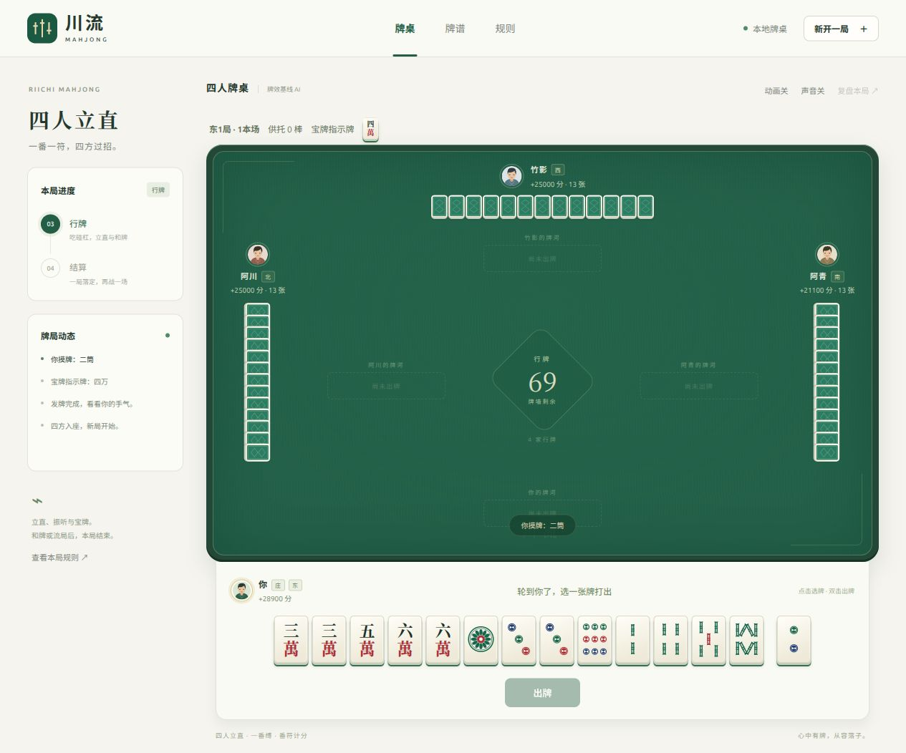

# Mahjong Sandbox

可游玩、可复现的川麻血战到底与四人立直麻将游戏和 AI 沙盒。已实现规则引擎、观察与回放、浏览器牌桌、日麻番符与整场流程，以及阶段 5 的增量牌数、编译算子、批量张量接口、多进程分片、策略评测与训练接口验证。



运行要求 Python 3.11+。牌桌与参考引擎无需第三方依赖；批量环境需要 NumPy，编译算子另外需要 Numba。请在项目根目录运行下列命令。

## 打开牌桌

```bash
python3 -m mahjong_sandbox serve
```

浏览器访问 **http://127.0.0.1:8765/**。你坐庄，对阵三位 AI。先选同门三张换牌，再选择缺门；行牌时点击手牌后确认出牌，也可双击或选牌后按 Enter。碰、杠、自摸、荣和及过牌按钮由引擎当前合法动作生成。胡牌后其余玩家继续，三家胡牌或牌尽后显示结算。

“新开一局”可选择川麻或日麻，以及牌效、优先胡牌或随机基线，关闭换三张或自动过牌，以及指定种子。牌效基线使用可见信息估算牌型距离与有效进张，尚未经过 RL 训练。界面支持桌面和手机，手机手牌较长时可横向滑动。

日麻支持吃、立直、一番缚、振听、宝牌/赤牌/里宝牌、番符计分及单局/东风战/半庄；和牌或流局后结束本局，整场中点击“下一局”继续。规则与 Python 接口见 [docs/RIICHI.md](docs/RIICHI.md)。

“牌谱”可打开内置川麻一炮三响或日麻立直荣和示例，亦可导入单局或整场 JSON；本局结束后可下载和复盘，支持单步、播放、进度条、返回开局、跳到结局和全桌手牌视角。进行中的对局不会提供完整牌谱，未胡对手的暗牌由服务端隐藏；胡牌后亮牌。刷新页面可恢复同一浏览器标签的牌局，服务重启后需要重新开局。服务采用内存存储，保留最近 32 桌和 8 份回放。

可使用 `--port 8766` 修改端口。前端没有构建步骤，牌面、牌背、头像和标识均为项目原创 SVG；实现和接口说明见 [docs/WEB.md](docs/WEB.md)。

## 运行一局并保存牌谱

```bash
python3 -m mahjong_sandbox simulate --games 1 --seed 44 --policy win-first --replay-dir replays
python3 -m mahjong_sandbox replay replays/round_44.json
```

`random` 在全部合法动作中均匀选择；`win-first` 优先选择合法胡牌，其余动作随机。两者只读取自己的 `Observation`，不读取完整状态。`--no-exchange` 可关闭换三张。

```bash
python3 -m mahjong_sandbox simulate --games 100 --seed 0 --policy random
python3 -m unittest discover -s tests -v
python3 scripts/validate_random.py --games 1000 --report /tmp/mahjong-validation.json
```

最后一条进行多种配置下的串行参考引擎验证，包含库存和分数守恒、终止检查及抽样回放。批量后端和性能报告见下节。

项目还提供从真实发牌开始的一炮三响规则示例，使用明确构造的牌墙，经历默认规则的换三张和定缺，全程通过合法动作推进，最终分数为 `[-3, 1, 1, 1]`：

```bash
python3 examples/three_winners.py
python3 -m mahjong_sandbox replay examples/three_winners.json
```


日麻命令示例：

```bash
python3 -m mahjong_sandbox simulate --variant riichi --games 10 --policy greedy
python3 -m mahjong_sandbox simulate --variant riichi --match south --seed 21 --policy greedy --replay-dir replays
python3 scripts/validate_riichi.py --games 1000
```

## Python 接口

```python
from mahjong_sandbox import Engine, RandomAgent, Phase, save_replay

engine = Engine(seed=44)
agents = [RandomAgent(seed=p, prefer_win=True) for p in range(4)]
while engine.state.phase != Phase.TERMINAL:
    player = engine.next_player()
    observation = engine.observe(player)
    action = agents[player].act(observation)
    transition = engine.submit(player, action, observation["decision_id"])
    # 面向玩家的服务层只能发送这个投影，不应发送完整 Transition。
    public_update = transition.for_player(player)

print(engine.state.scores, engine.state.end_reason)
save_replay(engine, "replays/example.json")
```

`next_player()` 是内置调度器。换牌、定缺、碰杠胡响应窗口也允许按任意顺序提交各方动作；相同选择的裁决结果不受响应到达顺序影响。已经提交的玩家不能重复提交。每次提交必须带当前 `decision_id`。

`engine.state`、`snapshot()`、完整 `events`、完整 `Transition` 和回放文件是裁判/调试信息，含隐私牌。普通 agent 只使用 `observe(player)`；对玩家发送事件时使用 `transition.for_player(player)`。返回的玩家观察和事件投影均与引擎数据隔离。

## 已实现的边界

- 108 张实体牌；34 种基础牌编号；副露、牌河、待裁决响应和零和结算账本。
- 普通和型、川麻七对及龙七对，多种拆解比较，结构听牌与查大叫最高分计算。
- 换三张、定缺、缺门优先打出、碰、三种杠、自摸、荣和、一炮多响、抢加杠。
- 胡后继续、跳过已胡玩家、补牌、三家胡牌结束、牌尽响应后结算。
- 平胡、对对胡、带幺九、将对、金钩钓、清一色、根及情景加番。
- 杠分、查花猪、查大叫、未听牌者退杠分；过胡限制及可选呼叫转移。
- 非法动作拒绝、逐提交不变量验证、固定牌墙回放和双校验和。

完整规则定义见 [docs/RULES.md](docs/RULES.md)，架构与格式见 [docs/DESIGN.md](docs/DESIGN.md)。本项目固定的是明确的 `sichuan_xuezhan_v1` 规则配置，不声称与所有地方或平台的四川麻将完全相同。日麻采用独立的 `riichi_4p_v1` 引擎，完整边界见 [docs/RIICHI.md](docs/RIICHI.md)。

## 阶段 5：批量训练环境与性能

```bash
python3 -m venv .venv
.venv/bin/python -m pip install '.[fast]'
.venv/bin/python -m mahjong_sandbox benchmark --games 20 --boards 1000 --workers 0 1 2 4 --output /tmp/benchmark.json
.venv/bin/python -m mahjong_sandbox batch-smoke --variant sichuan --boards 1000 --workers 4 --output /tmp/sichuan-batch.json
.venv/bin/python -m mahjong_sandbox batch-smoke --variant riichi --boards 1000 --workers 4 --self-play --output /tmp/self-play-batch.json
.venv/bin/python -m mahjong_sandbox evaluate --variant sichuan --blocks 50 --workers 4 --output /tmp/sichuan-eval.json
.venv/bin/python -m mahjong_sandbox evaluate --variant riichi --blocks 50 --workers 4 --output /tmp/riichi-eval.json
.venv/bin/python -m mahjong_sandbox training-smoke --boards 32 --steps 160 --workers 2 --output /tmp/training.json
.venv/bin/python -m unittest discover -s tests -v
```

仅使用 NumPy/Python 后端可安装 `.[batch]`，并传 `--backend python`。已有本项目 `.venv` 时无需重建。五种 bot 都只消费自己的可见观察：随机、胡牌优先、牌效、防守、保留价值牌。评测让被测策略轮坐四个座位，对阵三家牌效 bot，复用牌墙种子，输出胡牌率、放铳率、平均净得分、最高分比例及区间；川麻允许一局多人胡牌。

`SyncBatchEnv` 与 `ProcessBatchEnv` 提供相同接口，默认一个学习座位、三家自动 bot，也支持四家自博弈。下面的动作只是接口示例，实际模型应使用候选动作特征及合法掩码评分：

```python
import numpy as np
from mahjong_sandbox import BatchConfig, ProcessBatchEnv

def main():
    with ProcessBatchEnv(1000, 4, BatchConfig(variant='riichi')) as env:
        batch = env.observation()
        for _ in range(100):
            actions = batch['action_mask'].argmax(axis=1).astype(np.int64)
            actions[batch['terminated']] = -1
            batch = env.step(actions, batch['tokens'])
            # 先记录这一步的四家 rewards、终局观察与 terminated，再重置。
            # 默认学习座位为 0；日麻原始分数可除以 1000 后训练。
            if batch['terminated'].any():
                batch = env.reset_done()

if __name__ == '__main__':  # spawn 进程必须保护程序入口
    main()
```

设计、张量字段、并发边界和实测报告见 [docs/PERFORMANCE.md](docs/PERFORMANCE.md)。`training-smoke` 实际运行短程 REINFORCE，验证轨迹、奖励、合法采样与参数更新；优秀 agent 的网络、训练配方和大规模自博弈属于阶段 6。当前批量环境的 episode 是一手牌，日麻整场仍由 `RiichiMatch` 提供；CPU 上的规则状态机与 NumPy/Numba 算子已有实现，GPU 整局引擎尚未实现。
