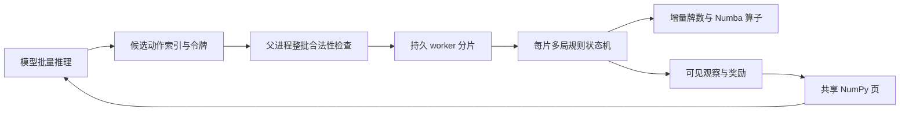

# 阶段 5：并发、算子与训练环境

## 实现范围

规则仍由川麻 `Engine`、日麻 `RiichiEngine` 裁决。`FastEngine` 和 `FastRiichiEngine` 继承同一套行牌、计分与结算逻辑，优化运行路径；`SyncBatchEnv` / `ProcessBatchEnv` 用同一个接口管理大量正在进行的牌局。

当前环境的 episode 是一手牌，日麻东风/半庄由原有 `RiichiMatch` 提供，尚未接入批量 episode。阶段 5 提供可训练环境和真实参数更新验收；优秀 agent 的模型与长期训练属于阶段 6。

## 剖析结果与选择

最初的三局日麻牌效剖析记录在 [stage5-baseline.json](stage5-baseline.json)。CPython 3.14 的 cProfile 总耗时 3.445 秒，策略向听计算累计约 2.04 秒、观察约 1.34 秒、合法动作约 0.73 秒、深复制约 0.58 秒。这些是嵌套累计时间，不能相加。计时基准使用同一个 Python 3.12 解释器比较后端；不拿这次 3.14 剖析与 3.12 的吞吐量直接相除。

对应改动：

- 暗牌 `TileList` 在摸牌、出牌、吃碰杠和换牌时维护 34 类计数，避免反复从实体牌重数；仍保留实体牌以区分赤牌和验证库存。
- 合法动作按 `(revision, decision_id)` 缓存，观察与提交共享本次结果；密封响应提交后立即失效。
- rollout 默认关闭命令与事件历史，观察只生成当前可见状态。参考引擎及 `RuntimeOptions(record=True)` 保留完整可验证回放。
- rollout 在构造与终局检查完整库存/账本，`validate_every=1` 可恢复逐动作验证；每次提交仍检查决策令牌与合法动作，非法输入检查没有关闭。
- 向听、结构和牌/听牌、弃牌距离与有效进张使用整数 Numba 算子。番符、振听、碰杠限制与支付仍调用规则引擎；结构听牌不等于有役且可荣和。
- 牌效 bot 先计算全部弃牌的距离，再对**合法候选中的最小距离牌**计算有效进张。这保留原策略的评分和随机平局选择。第一次直接计算每张牌的有效进张仍是热点，后续剖析据此减少了计算量。

这次采用固定形状数组、增量计数和多进程分片。四家、34 类牌本身适合数组；规则分支、响应优先级与两种终局流程仍适合明确的状态机。完整 ECS 框架不会直接消除向听或复制热点。Torch 更适合模型训练和批量推理，当前没有把分支密集的整局规则移到 GPU。

Numba 的整数算子以 `nogil=True` 编译，按数组行运行；没有声称所有规则已 SIMD 化。多进程提供牌局级 CPU 并发。所验运行环境中，递归 Numba 算子的磁盘缓存在新进程加载后发生过段错误，因此关闭磁盘缓存，各持久进程首次使用时编译、随后复用内存中的机器码。启动/编译时间单独报告，短任务可能不值得启用该后端。

相关实现依据：[Numba 性能说明](https://numba.readthedocs.io/en/stable/user/performance-tips.html)、[Python 进程执行器](https://docs.python.org/3/library/concurrent.futures.html)、[NumPy 并行随机数说明](https://numpy.org/doc/stable/reference/random/parallel.html)。本项目实际采用 BLAKE2b 从 `(base_seed, lane, episode, stream)` 派生独立牌墙及各 bot 种子，结果不依赖 worker 数或调度顺序。

## 并发与生命周期

一个 worker 持有一个分片中的多局引擎，1000 局分给 4 个 worker，而不是创建 1000 个进程。使用显式 `spawn`，程序入口应有 `if __name__ == '__main__'`。父进程管理控制管道及共享文件；数组映射同一个临时文件的内存页，各 worker 只写自己的连续行区间。文件位于临时目录，工作期间使用 OS 页缓存；这里实现的是文件映射共享内存，不是 `/dev/shm` 专有资源。

每次只经管道发送动作索引、令牌和小型确认消息；完整观察和奖励写入共享数组。全部 worker 确认后父进程才读取并返回独立只读快照，旧快照不会随下次 step 改写。共享缓存大小及采样 RSS 在基准中记录。RSS 的进程求和会重复计算共享页，因此不能当作独占内存。

`step_async(actions, tokens)` / `step_wait(timeout)` 可把模型或日志工作安排在等待期间。环境不允许同时提交两个 step，也不允许请求尚未完成时读取共享缓存。超时表示同一个请求仍在运行，可以再次 `step_wait`；不会重启 worker 或重复执行动作。worker 异常/退出使环境失效，必须关闭并显式新建。上下文管理器的 `close()` 关闭管道、等待/终止 worker 并删除映射文件。

整批索引、掩码、episode 和决策令牌在任何一局改变前检查。规则内部异常属于环境失败，不能把部分运行结果当作正常训练 transition。不会把内部错误伪装成流局或 `truncated=True`。

## 训练 API 与信息边界

默认 `controlled_player=0`，其余三家通过自己的观察自动行动。一次 step 执行学习座位选择，并运行对手直到该座位的下一次决策或整手结束；奖励包括这段期间所有分数变化。川麻学习者胡牌退出后，其余玩家继续，直到整手结算；同一 transition 带回剩余收益，因此没有丢失查叫、退杠等延后奖励。

`controlled_player=None` 表示四家自博弈：每局每次返回当前等待提交的座位。模型应以 `(lane, episode, player)` 路由各家的 RNN 状态与轨迹，并将四维分数变化分配给对应座位；不能把相邻两个座位当作同一个 agent 的相邻决策。

所有输入数组从 `engine.observe(player)` 投影。牌墙、死牌山、对手暗牌、其他家的振听状态与密封选择均不进入模型观察。公开河牌、副露、宝牌、已胡亮牌使用实体牌 ID，计数去重。规则配置属于公开环境配置；模型应固定在已知 profile 下训练，或自行加入 profile 特征。

| 字段 | 形状 / 类型 | 含义 |
| --- | --- | --- |
| `own_counts`, `known_counts` | `[N,34] uint8` | 本家暗牌、所有可见实体牌的分类计数 |
| `concealed` | `[N,14] int16` | 本家实体牌，空位为 -1 |
| `revealed` | `[N,4,14] int16` | 本家及已公开的赢家暗牌，其余为 -1 |
| `seats` | `[N,4,7] int32` | 暗牌数、缺门、是否继续、立直、双立直、立直弃牌、自风 |
| `exchange_offsets` | `[N] int8` | 川麻换牌完成后公开的方向偏移 1/2/3，尚未公开或日麻为 -1 |
| `rivers`, `river_flags`, `river_lengths` | `[N,4,136] int16/uint8`，`[N,4] uint8` | 河牌及摸切/被鸣/被和/立直标记；上限采用整个牌组容量 |
| `melds` | `[N,4,4,9] int16` | 副露类型、四个实体牌槽、来源、被鸣牌、加杠牌、牌数 |
| `meta` | `[N,16] int32` | 阶段、观察座位、行动方、余牌、庄家、场风、局数、本场、棒、待应牌、本家摸牌及本家振听等；字段顺序为 `META_FIELDS` |
| `scores` | `[N,4] int64` | 四家原始分数 |
| `wins` | `[N,4,8] int32` | 按和牌记录顺序：赢家、来源、实体牌、自摸、番、符、荣和支付值、役满数；空行 -1 |
| `dora`, `ura`, `red_mask` | `[N,5] int16`、`[N,136] bool` | 公开指示牌、允许公开时的里宝牌及赤牌配置 |
| `actions` | `[N,512,8] int16` | 类型码、消耗牌数、四个实体牌槽、缺门参数、副露索引 |
| `action_mask` | `[N,512] bool` | 当前合法候选 |
| `tokens` | `[N,2] uint64` | episode 及本环境决策计数，防止窗口内换座位或重置后的旧动作 |
| `decision_ids` | `[N] int64` | 规则引擎决策窗口 ID |
| `rewards` | `[N,4] float32` | 本次 step 的原始分数增量 |
| `terminated`, `truncated` | `[N] bool` | 整手自然结束；当前实现不会产生截断 |

类型码由 `ACTION_KINDS`、`PHASES`、`MELD_KINDS` 导出，其他空位 -1。512 能容纳最多 `C(14,3)=364` 个换三张候选。动作索引是**当前菜单里的候选位置**，不能当成全局稳定的牌/动作分类；模型需要评分候选特征。提供的 `candidate_features()` / `masked_policy()` 展示了向量化候选评分与合法采样。

结束行必须提交 `-1`，重复 step 的奖励为 0。没有隐式 autoreset：先存终局观察、奖励和 `terminated`，再 `reset_done()` 或 `reset(indices)`；reset 返回的新观察奖励为 0，并更换 episode 令牌。自然终局的价值 bootstrap 应为 0。默认单座位可直接使用 `rewards[:,0]`；日麻奖励是原始点数，可除以 1000。立直供托未领取时留在棒池，不能错误要求四家收益之和总是 0。

纯 NumPy 路径可工作，模型侧可把数组复制/转换成 Torch 张量。此阶段实际验证的是 NumPy REINFORCE，没有把未经验证的 Torch/GPU 路径计入验收。

训练示例在一批轨迹全部完成前固定策略权重，已结束的行提交 -1 等待；整批结束后用完整回报更新一次，再显式重置。报告的 `episodes` 包括最后一批中已经结束但尚未用于更新的轨迹；实际参与更新的轨迹数为 `environments × updates`。36 个候选特征还包含定缺花色与副露索引，避免不同参数的动作得到完全相同的输入。这个小型线性模型用于验证训练链路，不用于评估 agent 的竞技强度。

## 算子 API

`shanten_batch(counts, meld_counts, ...)` 返回 `[N] int8`；`waits_batch` 返回 `[N,34] bool`；`discard_ukeire_batch` 返回 `[N,34] int8` 距离及 `[N,34] int16` 可见有效进张。输入须为整数 `[N,34]`、每类 0–4、副露数 0–4；允许不足 13 张的中间牌效状态，但不能超过 `14 - 3 * melds`。川麻字牌位置必须为 0。不存在的弃牌距离为 127。

`best_only=True` 只计算最小距离的候选有效进张，其余有效进张为 0；`candidate_mask` 可以约束缺门等合法弃牌范围。默认计算全部现有牌类的有效进张。算子复制会被原地递归修改的计数工作区，调用者输入保持不变，可并发调用。结构运算不包含番缚、振听、已经拥有的副露中的第五张限制等规则判断，游戏决策必须使用引擎的合法菜单。

## 实测与策略比较

<!-- RESULTS:START -->
实测环境为 Python 3.12.14、NumPy 2.3.5、Numba 0.68.0，Linux x86-64，16 个可见/可调度逻辑 CPU。两局预热含首次算子编译约 7.55 秒。下表是同一解释器、相同种子与四家牌效策略的 20 局单次基准，三种后端的比分、命令数、赢家与结束原因均一致。

| 变体 | 后端 | 完整局/秒 | 命令/秒 | 相对参考 |
| --- | --- | ---: | ---: | ---: |
| sichuan | reference | 3.28 | 497 | 1.00× |
| sichuan | lean-python | 4.31 | 654 | 1.32× |
| sichuan | lean-native | 4.86 | 737 | 1.48× |
| riichi | reference | 0.80 | 150 | 1.00× |
| riichi | lean-python | 1.32 | 248 | 1.65× |
| riichi | lean-native | 4.31 | 809 | 5.38× |

1000 行数组运算（有效进张使用完整候选，输入/输出对照一致）：

| 算子 | Python 秒 | Numba 秒 | 比值 |
| --- | ---: | ---: | ---: |
| shanten_batch | 0.159 | 0.009 | 17.2× |
| waits_batch | 0.536 | 0.002 | 250.2× |
| discard_ukeire_batch | 33.387 | 3.523 | 9.5× |

1000 局日麻同时驻留、一个学习座位加三家自动牌效 bot；全部 1000 局均自然结束且奖励核对通过：

| worker | 启动秒 | 前 3 步秒 | 稳态决策/秒 | 全推进秒 | 采样 RSS 求和 MiB |
| ---: | ---: | ---: | ---: | ---: | ---: |
| 0 | 0.60 | 9.08 | 278 | 174.08 | 491 |
| 1 | 1.78 | 13.95 | 279 | 178.53 | 807 |
| 2 | 1.54 | 10.34 | 499 | 102.43 | 1050 |
| 4 | 1.61 | 8.73 | 849 | 62.91 | 1521 |

该次扩展性基准的共享数组为 11,370,280 字节，约 10.84 MiB。随后补全公开换牌方向与已公告牌的观察投影，最终版另跑了下面的 1000 局验收；保留这次同轮 0/1/2/4 worker 原始计时，不把不同运行轮次拼成扩展性结果。4 个 worker 相对 1 个约 3.04×；RSS 包含 LLVM、计数缓存、引擎、快照及重复计算的共享页。这里的主要 CPU 工作包含三家启发式 bot。

单独去掉启发式对手、四家都由外部策略决策的日麻自博弈接口试验，以及川麻批量试验：

| 变体与模式 | 驻留局数 | worker | 稳态决策/秒 | 全推进秒 | 自然终局 |
| --- | ---: | ---: | ---: | ---: | ---: |
| sichuan 单座位 + 三家牌效 | 1000 | 4 | 960 | 57.85 | 1000 |
| riichi 四家外部策略 | 1000 | 4 | 17410 | 16.38 | 1000 |

最终版 1000 行共享映射为 11,371,304 字节。四家外部策略试验选取合法胡牌，否则选首个候选，只测环境推进与观察传输；不包含模型推理/反向传播，也不代表强策略负载。不同阶段、鸣牌与胡牌会改变吞吐量。所有试验都核对了累计奖励和终局分数差。

五种策略对三家牌效 bot 的评测，每种策略每变体 200 局。胡牌率括号内为 95% 区间：

| 策略 | 川麻胡牌率 | 川麻平均净分 | 日麻胡牌率 | 日麻放铳率 | 日麻平均净分 |
| --- | ---: | ---: | ---: | ---: | ---: |
| random | 1.0% (0.0–2.5%) | -4.78 | 0.0% (0.0–7.1%) | 24.0% | -2294 |
| win-first | 2.0% (0.5–4.0%) | -4.71 | 0.0% (0.0–7.1%) | 24.0% | -2294 |
| greedy | 74.5% (73.5–75.0%) | 0.00 | 23.5% (21.5–25.0%) | 19.5% | -55 |
| defensive | 72.5% (69.5–75.0%) | -0.14 | 18.0% (15.0–21.0%) | 9.5% | 15 |
| value | 58.5% (52.0–65.0%) | -1.48 | 16.5% (13.0–20.0%) | 13.5% | -240 |

完整机器报告：[基准与剖析](stage5-benchmark.json)、[川麻 1000 局并发](stage5-batch-sichuan.json)、[日麻 1000 局自博弈](stage5-batch-self-play.json)、[川麻策略评测](stage5-evaluation-sichuan.json)、[日麻策略评测](stage5-evaluation-riichi.json)。
<!-- RESULTS:END -->

两种变体各评测 1000 局：50 个牌墙种子 × 5 种被测策略 × 4 个座位，对阵三家 `greedy`。同一牌墙的四个座位是相关样本，区间以牌墙块做 2000 次 bootstrap，而非把每局当成独立二项试验。全零/全一的有界指标用独立牌墙块的保守精确界限，避免 bootstrap 返回虚假的零宽区间；例如 200 局里没有胡牌不意味着真实胡牌概率为零。`win` 表示本家出现于自摸/荣和记录；`deal_in` 表示至少一次成为荣和来源，川麻可能同时胡牌和放铳；`top_score` 是终局最高原始分数比例，最高分并列按人数分摊。流局满贯反映在净得分中，不计入普通胡牌记录。它们都不是日麻半庄排名或 Elo。

比较采用当前固定规则和少量牌墙块。基线较随机策略更好、或某个 bot 的放铳率较低，不能证明训练出的强 agent 或充分泛化。特别是日麻防守策略降低放铳的同时减少胡牌，平均收益应结合区间看。

<!-- TRAINING:START -->
两种变体都完成了实际 REINFORCE 更新，合法采样错误为 0，参数与梯度有限，累计奖励核对通过：

| 变体 | 并发轨迹 | 完成轨迹 | 更新次数 | 用于更新的轨迹 | 参数范数 |
| --- | ---: | ---: | ---: | ---: | ---: |
| sichuan | 32 | 65 | 2 | 64 | 0.001441 |
| riichi | 16 | 36 | 2 | 32 | 0.008536 |

报告：[川麻训练链路](stage5-training.json)、[日麻训练链路](stage5-training-riichi.json)。
<!-- TRAINING:END -->

## 验收与复现

参见 README 的安装与新 CLI。`benchmark` 分别预热后端，再以相同种子/原策略验证比分、命令数、赢家与结束原因一致后计时；数组算子各预热一次，比较 1000 行的 Python/Numba 输出；1000 局批量试验一直推进到全部自然终局，逐局核对奖励累计与分数变化。前 3 步与启动单独列出，稳态指标为学习座位决策/秒，不混写成完整麻将局/秒。RSS 在 step 边界采样，不能保证捕捉所有瞬时峰值。

`tests/test_fast.py` 对两种引擎、开关配置及逐动作选择进行差分，记录模式重放验证双校验和；检查 2000 组随机手牌、特殊和型、暴露面子听牌、候选约束、输入不变及多线程算子调用。`tests/test_batch.py` 覆盖可见信息、非法整批拒绝、旧令牌、终局奖励、重置复现、密封决策换座位、1/2/4 进程一致性、请求超时继续等待、worker 退出及资源清理，并验证评测不依赖 worker 数、训练实际更新且可复现。

完整回归包含原有川麻/日麻规则边界、HTTP 牌桌和回放测试。参考游戏仍可在没有 NumPy/Numba 的 Python 环境运行，相关可选测试会跳过。

最终版本完整回归：带可选依赖的 Python 3.12 环境 120 项全部通过；无 NumPy/Numba 的 Python 3.14 环境通过回归，14 项可选依赖测试跳过。重新构建并安装 wheel 后，从项目目录外验证了无依赖游戏与回放、完整网页素材及 Numba 多进程批量接口。[验收记录](stage5-validation.json) 保存环境、测试结果、安装包及代码/素材校验和。
