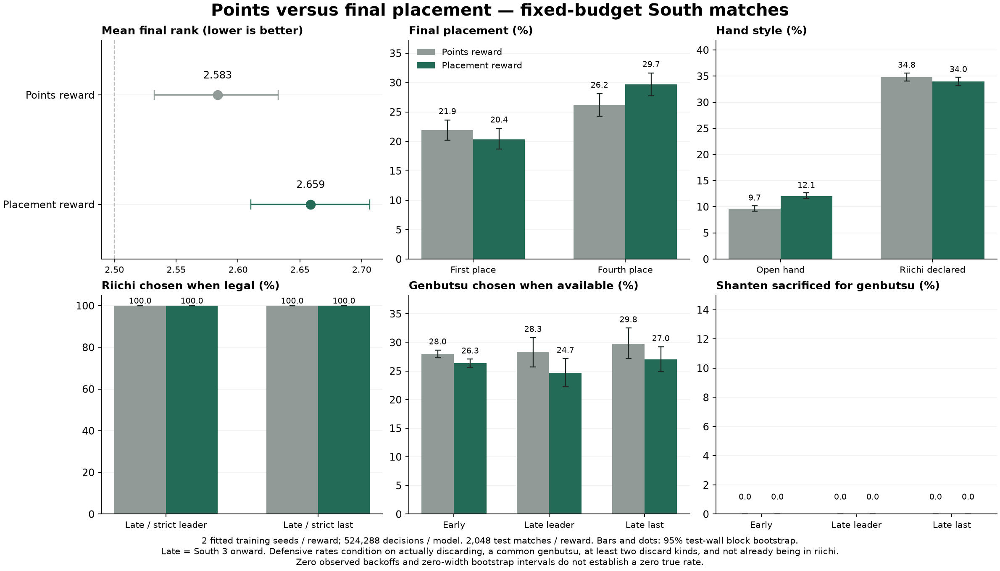

# 立直：净点数与最终排名的配对实验

本轮使用完整半庄（`riichi_match_v1`，25,000 点起始、30,000 点目标，含连庄、本场、供托、延长、击飞和和牌止），比较最终排名与净点数两种优化目标。实际赛事有不同的顺位点和返还规则；本实验明确使用纯平均顺位，不把它当作所有赛事统一的计分表。

## 奖励合同

`reward_mode="rank"` 时，半庄中间的奖励全部为 0，终局一至四位分别获得 **+1.5、+0.5、−0.5、−1.5**，即 `2.5 - rank`。奖励不含点数、立直、和牌或副露项，不能靠延长比赛多收奖励。要求 `gamma=1`、`reward_scale=1`，训练时使用 `gae_lambda=1`；同点按照本项目整场控制器的初始座次排序。允许配置四个严格递减的 `rank_rewards`。

净点数对照使用原有跨局点数增量 / 10,000。两组均核对完整 episode 回报：排名组等于最终名次对应的 utility，点数组等于最终净点数 / scale。两组都报告点数、顺位和牌风指标。选模与损坏检查点恢复均遵循本组目标：排名组按平均排名 utility 最大化，点数组按平均净点数最大化。

这是对平均顺位的优化，每提升一位的价值相同。末位惩罚更重的奖表是另一种目标，需要单独实验。

## 公平对照

- 共用上一轮 **0 PPO 步**的 12,000 条 greedy 决策模仿初始化（SHA-256 `82562978b74ec4adb6426ce0d2b4d68baaad3b81433f00d617f1ea5d23c50b57`）。不把点数训练过的价值函数和 Adam 直接用于另一套回报单位。
- 训练种子 **20261、20262**，每个种子各训练 score/rank 两组，共四个学习器；各追加 **524,288** 个可决策步。
- 每组 512 个并发半庄、32 步 rollout、1,024 minibatch、4 epoch、学习率 1e-4。两组统一 `gamma=1`、`gae_lambda=1`，其余参数相同，配置见 `configs/rl/riichi-south-score.json`、`riichi-south-rank.json`。
- 对手为固定的 greedy / defensive / value 混合。本轮不刷新自博弈对手，以便把目标差异解释清楚；既有训练框架仍支持历史自博弈。
- 验证使用逻辑种子 **120000–120015**、四座轮换；支持 CPU 并行验证。测试使用 **600000–600255**，每个候选 **1,024 场半庄**，与验证分开。
- **主分析使用相同步数预算的最终模型**，并列出两个训练种子的结果。验证选出的最佳模型为次分析，绝不根据测试集挑训练种子或检查点。

加大并发本身不会保证方差下降。本轮同时增加采样总量、使用两个训练种子，并用同牌墙四座轮换的配对测试减少比较噪声。区间按测试牌墙种子块重抽样，保留同一牌墙四座和两个已训练模型的相关性；它是给定这两个训练种子的测试区间，不代表对所有重新训练的总体区间。

## 观察策略变化

除了胡牌率、放铳率、平均顺位、一位率、四位率、净点数、副露率、杠和立直率，还单独统计：

- 南三局起、严格领先时，与严格末位时的决策；并列分数归入其他位置。
- 有合法立直机会时是否立直，有合法鸣牌机会时是否鸣牌，有合法和牌机会时是否和牌。
- 实际选择弃牌（含立直宣言牌）、尚未立直、至少有两种可弃牌、且有对所有立直对手的共同现物时，是否选择现物、是否为此牺牲向听数。选择和牌、杠等其他动作的局面不进入该弃牌指标的分母。

这些是可见行为指标，不能只凭少副露就判定防守，也不能把两组在不同局面上的条件比例直接当成相同局面的因果效果。总顺位差使用完整固定测试集的配对结果判断。

## 运行与恢复

```bash
# 准备独立计划及四份配置；initial 必须是零步 BC 模型。
python scripts/run_placement_ablation.py --root runs/placement \
  --initial mahjong_sandbox/models/riichi-rank/warmstart.zip \
  --legacy mahjong_sandbox/models/riichi-high/best.zip --workers 8

# 每个学习器单独启动，可在不同 CPU 作业上共享持久目录。
python scripts/run_placement_ablation.py --root runs/placement \
  --worker-config runs/placement/rank_20261.json \
  --output runs/placement/rank_20261 --initial runs/placement/initial.zip

# 四组达到固定目标后才允许测试。
python scripts/run_placement_ablation.py --root runs/placement \
  --evaluate --eval-blocks 256 --eval-workers 16
```

计划记录初始哈希、源码哈希、每份配置的哈希和固定目标；单组控制器重启不会重复追加训练量。SIGTERM 在完整更新边界保存；硬中断从最新完整不可变检查点恢复。更换已经训练的奖励单位须从独立零步 warmstart 开始，不静默恢复另一目标的 Adam 状态。

顺位检查点也可通过现有 Agent 接口接入对局；传入引擎为该玩家生成的公开观察即可：

```python
from mahjong_sandbox.rl.agent import RLAgent

agent = RLAgent("mahjong_sandbox/models/riichi-rank/best.zip", device="cpu", backend="numba")
action = agent.act(observation)
```

可运行 `python scripts/verify_placement_release.py`，用临时副本检查 CPU 加载、合法动作和 Adam 续训；原权重的哈希必须保持不变。

## 相同局面的补充诊断

另用 700000–700031 的 32 场 greedy 半庄收集公开观察，按阶段/名次与立直、和牌、鸣牌、面对立直的安全弃牌机会做 reservoir 抽样，每个类别上限 200，交叉类别去重后共 **1,977 个局面**。其他三家的暗手不进入数据，公共历史仅保留特征合同所需的规则公告与牌河/副露。

固定局面库见 `docs/placement/decision-bank.json.gz`，SHA-256 为 `e8c38c2d4eab78f1d2d402803ea477c0861f47199978b8d9f03b8f5cc522b33a`；生成清单记录代码与数据哈希。该数据在四组训练完成前已固定，不参与训练、选模或主测试。局面类别经过抽样，其动作比例用于相同输入的诊断，不当作真实对局频率。

```bash
python scripts/placement_decision_probe.py --collect \
  --bank runs/placement/decision-bank.json.gz --blocks 32 --seed 700000
python scripts/placement_decision_probe.py \
  --bank docs/placement/decision-bank.json.gz \
  --models rank=RANK_MODEL.zip score=SCORE_MODEL.zip \
  --output runs/placement/decision-probe.json
```

<!-- measured-results -->
## 2026-10-20 固定预算实验结果

本轮纯顺位奖励未改善排名。相同预算的最终模型中，两个种子都是顺位模型更差；两个目标的模型平均顺位均差于 greedy 基线的 2.5。该结论针对本轮配置与两个已训练种子，不能推广为顺位奖励本身无效。

四个学习器均完成 524,288 步，共 2,097,152 个可决策步。实际复用 CPU 沙盒，16 CPU 请求、32 CPU 上限、32 GiB 内存，0 GPU；每组 512 个并发半庄、8 个环境进程，总并发 2,048、环境进程 32。

下表使用相同预算的最终模型，两个训练种子合并。每个最终模型测试 256 个新牌墙种子、四座轮换，共 1,024 场半庄；每个目标合计 2,048 场。对手均为三家 greedy。

| 优化目标 | 平均顺位 | 一位率 | 四位率 | 胡牌率 | 放铳率 | 平均净点数/半庄 |
|---|---:|---:|---:|---:|---:|---:|
| 净点数 | 2.5835 | 21.88% | 26.22% | 20.70% | 17.09% | -1147.5 |
| 最终顺位 | 2.6587 | 20.36% | 29.69% | 20.43% | 18.13% | -2185.4 |

顺位目标减点数目标的平均顺位差为 **+0.0752**，95% 配对牌墙块区间 **[+0.0059, +0.1406]**；顺位差为负代表排名更好。四位率差为 **+3.47 个百分点**，区间 [+0.73, +6.20]。

| 训练种子 | 点数模型平均顺位 | 顺位模型平均顺位 | 顺位差 |
|---|---:|---:|---:|
| 20261 | 2.5635 | 2.6895 | +0.1260 |
| 20262 | 2.6035 | 2.6279 | +0.0244 |

区间只描述这两个已训练种子在独立牌墙上的比较。两个训练种子不能充分刻画重新训练的总体方差；牌风为探索性指标，未做多重比较校正。完整结果和其他基线见 [评测数据](placement/evaluation.json)，逐场顺位、得分和行为计数见 [压缩数据](placement/test-counts.json.gz)，可按牌墙块重算区间。

### 牌风

| 指标 | 净点数模型 | 顺位模型 |
|---|---:|---:|
| 副露率 | 9.68% | 12.06% |
| 立直率 | 34.81% | 33.98% |
| 平均和牌番数 | 3.40 | 3.35 |
| 平均和牌收入（含本场、供托等） | 8058.81 | 7905.76 |
| 每百手杠数 | 1.91 | 2.44 |
| 有共同现物时选现物 | 28.01% | 26.22% |
| 牺牲向听数选现物 | 0.00% | 0.00% |
| 南三起严格领先时选择合法立直 | 100.00% | 100.00% |
| 南三起严格末位时选择合法立直 | 100.00% | 100.00% |
| 南三起严格领先时牺牲向听选现物 | 0.00% | 0.00% |
| 南三起严格末位时牺牲向听选现物 | 0.00% | 0.00% |
| 南三起严格领先时选择合法和牌 | 100.00% | 100.00% |
| 南三起严格末位时选择合法和牌 | 100.00% | 100.00% |

现物选择是在实际选择弃牌（含立直宣言牌）、尚未立直、至少有两种可弃牌且存在共同现物时统计；牺牲向听仅计算选中现物且比最佳合法弃牌的向听更差。条件比例的分母随实际遭遇局面变化，应结合下面的相同输入诊断判断。零事件不代表真实概率严格为零。



### 相同公开局面的动作比较

固定局面库包含 1977 个局面。各模型使用相同可见状态、相同合法动作菜单确定性推理；每个模型另检查 4 个局面的批量与单 Agent 输出一致。

| 训练种子 | 顺位与点数模型动作不同的局面 | 比例 |
|---|---:|---:|
| 20261 | 161/1977 | 8.14% |
| 20262 | 164/1977 | 8.30% |

这些局面经过分层抽样，动作分歧是相同输入的诊断，不是实际对局的动作频率。具体计数与分阶段结果见 [局面诊断](placement/decision-probe.json)。

四个最终模型都选择了 313/313 次合法立直与 263/263 次合法和牌；南三起严格领先时为 24/24 次立直，严格末位时为 28/28 次立直。所有模型都没有出现牺牲向听数选现物。动作分歧主要是弃牌（含立直宣言牌）与少量鸣牌；尚未观察到明确的领先收手、末位追击或见逃行为。晚场样本有限，不代表这些行为在所有局面都不可能出现。

作为参照，同一奖励目标的两个训练种子之间，点数模型动作分歧为 7.59%，顺位模型为 8.50%，与更换奖励目标时的分歧接近。因此不能仅凭约 8% 的不同动作就判定形成了独特的顺位牌风。

### 局限与下一轮方向

验证集只有 16 个牌墙块，此次验证表现未能推广到独立测试：发布模型验证平均顺位 2.375，独立测试为 2.668。检查点保留用于复现和继续训练，默认高难度模型保持原版本。

模型共用 greedy 模仿初始化。补充检查固定局面的随机策略概率，四个模型在各阶段的平均合法立直概率均超过 99.98%，与确定性动作结果一致。这说明本轮立直选择已经高度饱和；目标变化尚未明显改变它。该概率分析是在训练结束后追加的诊断，不参与训练、选模或主比较。

下一轮可独立比较降低模仿强度、加入防守教师、提高关键动作的探索，以及更强对手或历史自博弈，并增加训练种子与验证牌墙。现有数据不能单独确定本轮表现变差的原因；增加并发也不保证改善策略。

训练日志、源码哈希、预检和两组配置见 [训练记录](placement/training.json)。所有训练都达到预定目标后才运行最终测试；测试没有用于更换超参数或选模。

本轮源码通过本地全套 158 项测试与沙盒预检。发布权重的 CPU 参数和 Adam 状态均有限，临时副本续训 32 步产生参数更新，原权重哈希不变。wheel 解包后可加载既有川麻、点数立直、顺位模型和共用初始化，并各自给出合法动作；导出的 10,240 场计数精确重现两个目标的汇总与区间。验证记录见上面的训练记录。
