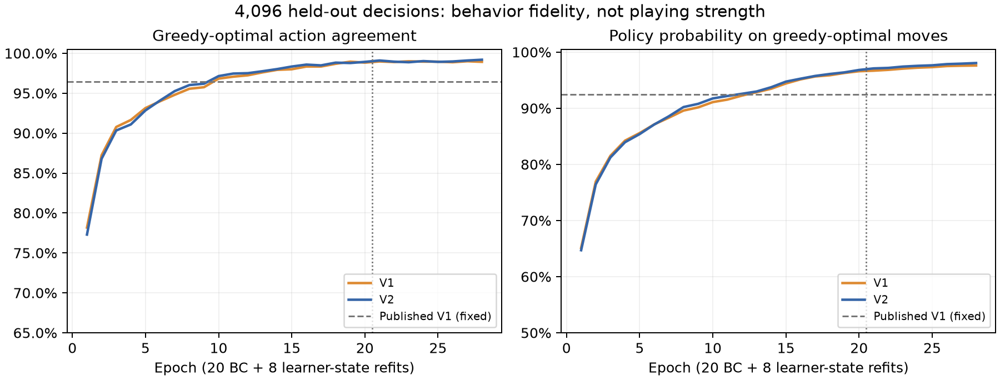
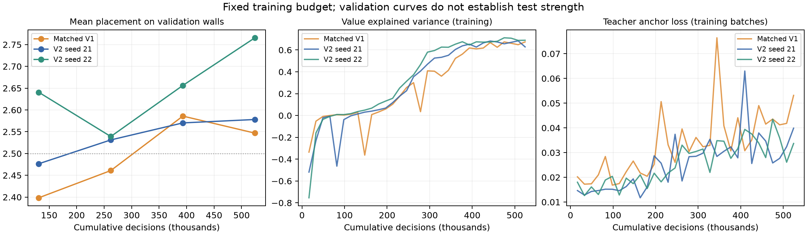
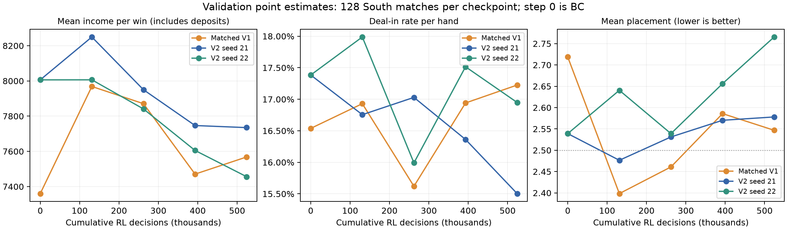
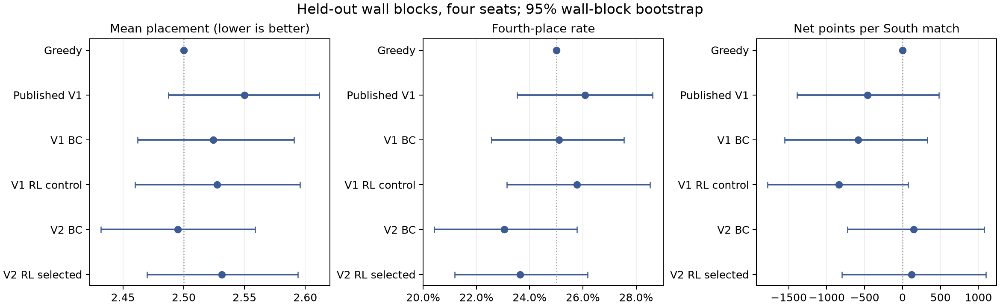

# 四人立直：greedy 蒸馏与混合自博弈

V2 输入合同见 [四人立直 RL](RIICHI-RL.md)。本流程在完整半庄上先学习 greedy 的公开信息决策，再用最终顺位训练。采用现有 SB3-contrib MaskablePPO，并扩展离线蒸馏、learner 局面标注、教师保留损失和独立评测。

## 冷启动与验收

教师只接收玩家观察。它选出的平手优选动作构成标签集合；损失是集合上总概率的负对数，不把一次随机平手选择当成唯一正确答案。普通实体副本仍按现有语义动作合同合并，赤牌和摸切保留区别。报告同时列出与随机抽取标签的完全一致率和与优选集合的一致率。

训练数据按完整比赛的种子分组，训练与验证没有共同比赛。分片保存特征、教师集合、动作类别、受立直威胁标记及比赛 ID；数据集清单记录逐片 SHA-256、规则和生产源码。相同公开局面同时提供 V1/V2 特征，便于训练流程相同的输入对照。

默认采集 32,768 条教师示范和 4,096 条独立验证样本，拟合 20 轮。然后让每个版本的 learner 占一个轮换席位，另三家为 greedy；learner 的行为有 25% 概率采用教师动作，否则采用自己的策略。在这些新局面上继续查询教师，追加 8,192 条标注，与原数据一起拟合 8 轮。这是一次 DAgger 式数据补充。

验收门槛为：总体及弃牌优选一致率至少 94%，鸣牌至少 90%，立直至少 98%，和牌至少 99.5%，受威胁局面至少 90%。杠牌单独报告准确率、概率和样本数。选模首先减少门槛不通过项与差距，再选择总体优选一致率最高者，以总体交叉熵打破平手。只有通过验收的冷启动才能进入 RL。

初次试跑发现，直接用各动作类别等权的宏平均交叉熵选模，会让极少数过度自信的杠牌错误压过大量常规决策，舍弃整体接近 99% 的模型而选中约 92% 的模型。门槛成功拦截了该模型。正式流程已修正选模规则；试跑数据与报告保留，尚未使用独立比赛测试集。不可变的教师/验证特征可以导入新实验，保留原生产源码与文件哈希，learner 局面则根据新选出的模型重新采集。

### 本轮冷启动结果

同一组 4,096 个独立局面，教师集合包含牌效相同的优选动作：

| 模型 | 优选一致率 | 优选集合概率 | 非优选动作数 | 同向听而进张更少 |
|---|---:|---:|---:|---:|
| 已发布第一版 | 96.44% | 92.44% | 146 | 98 |
| V1 输入＋新蒸馏 | 99.00% | 97.57% | 41 | 7 |
| V2 输入＋新蒸馏 | 99.19% | 98.05% | 33 | 11 |

三者均未在这组局面漏和或主动退向听。主要改善来自更完整的示范训练；单看冷启动，V2 对 V1 新蒸馏的差距远小于训练流程相对旧版的差距。优选一致率不能替代对战验收，教师本身也不具备完整的局势防守策略。原始统计见 [冷启动审计](riichi-curriculum/coldstart-error-audit.json)。



## 顺位 RL 与对手

环境仅在整场结束给 `[1.5, 0.5, -0.5, -1.5]` 的顺位奖励，`gamma=1`、`gae_lambda=1`，没有和牌、立直或净点数奖励。默认半庄为 25,000 点起始、30,000 点目标，支持连庄、本场、供托、击飞、和牌止及延长规则。

每个对手席位在整场开始时，有 50% 概率使用 greedy，另 50% 从冻结的历史模型池选择。池保留最近八个快照，每四次 PPO 更新发布一次；正在进行的比赛不会更换对手。默认每个 learner 并发 512 场、12 个 CPU worker，每 16,384 个决策更新一次。

为减轻 PPO 忘记基础动作，每次 PPO 更新后使用其已保存的 Adam 优化器做四次教师保留更新，每次 256 条样本，损失系数 0.05。该项是额外监督损失，不是环境奖励。PPO、教师保留更新、保存、快照和验证按同一顺序执行；恢复继续加载策略、价值网络与 Adam。

默认运行一个 V1 对照和两个 V2 训练种子，每个 524,288 步。V1 对照使用相同教师数据、补充数据量、奖励、历史对手比例和教师保留设置。已发布第一版模型另作为历史对照；它的输入、训练预算、比赛长度和奖励不同，单独比较不能把全部差异归因于 V2 输入。

## 独立对比与发布门槛

训练中的即时验证用于观察走势。完成固定预算后，统一在原验证牌墙上重评每个模型的四个全局候选步数：131,072、262,144、393,216、524,288。这样即使中途恢复，候选点也不会随本次运行的局部更新计数错位。候选哈希先写入 `validation-candidates.json`，再按平均顺位选模；两个 V2 种子之间也只用验证结果选择主模型。所有待测文件的哈希在比赛测试前冻结。默认独立测试 256 个牌墙块、四座轮换，每个候选 1,024 场，比较 V2 RL、V2 蒸馏、V1 同流程对照、V1 蒸馏、已发布 V1、greedy 和 defensive。

报告平均顺位、一位率、四位率、胡牌率、放铳率、平均整场净点数，以及立直、副露、现物选择和牺牲向听的防守代理指标。比例指标按实际完成手数统计。95% 区间对整场牌墙块重抽样，保留四座相关性；相对模型的差异使用同一牌墙的配对区间。两次训练不能代表任意重训的总体不确定性。

发布门槛要求主模型相对 greedy、相对 V2 蒸馏模型的平均顺位差，其 95% 区间上界均小于 0。不通过时保留实验模型和报告，不替换游戏 AI。净点数为正、训练对手中的胜率提高或教师一致率较高，都不能单独证明棋力超过 greedy。

### 本轮训练曲线与固定局面

三组均完成 524,288 个有选择的决策，即各 32 次 PPO 更新。四个预定候选中，V1 对照及 V2 主种子均选中 131,072 步；另一个 V2 种子选中 262,144 步。后半程的价值解释率上升，但验证顺位没有持续改善，不能据此认定训练时间越长越强。所有种子中验证最好的是 V1 对照，另保存在实验模型的 `control.zip`；V2 的 `best.zip` 始终表示 V2 主模型。



V2 主种子在同一组验证牌墙上的变化如下。打点指每次和牌的平均收入，包含本场和供托；位次及净点数按整场统计，胡牌和放铳按实际手数统计。

| RL 决策数 | 平均和牌收入 | 胡牌率 | 放铳率 | 平均位次 | 净点数/半庄 |
|---|---:|---:|---:|---:|---:|
| 0，蒸馏后 | 8,006 | 22.15% | 17.38% | 2.5391 | −177.3 |
| 131,072 | 8,250 | 21.33% | 16.76% | **2.4766** | −714.8 |
| 262,144 | 7,950 | 21.54% | 17.03% | 2.5313 | −106.3 |
| 393,216 | 7,747 | 21.16% | 16.36% | 2.5703 | −1,282.0 |
| 524,288 | 7,735 | 22.40% | **15.50%** | 2.5781 | −23.4 |

从早期候选到终点，放铳减少、净点数改善，但打点下降且平均位次变差；这轮优化没有稳定改善其实际顺位目标。副露手数比例从 9.60% 升至 13.80%，立直从 35.57% 降至 32.71%。立直机会本身也随轨迹变化，不能直接解释为更懂得拒绝立直或防守。这些都是 128 场验证比赛上的点估计，不替代独立测试的配对区间。零步统计来自原始日志中与正确冷启动哈希对应的首次验证，见 [证据](riichi-curriculum/coldstart-match-validation.json)。



在同一组 4,096 个教师验证局面上，选出的 V2 RL 优选一致率为 **98.93%**，非优选动作 44 个；蒸馏模型为 99.19%、33 个，旧发布版为 96.44%、146 个。三者在该组局面都未漏和或退向听。RL 出现了少量基础行为漂移，并非更长训练必然提高教师一致率。统计见 [训练后审计](riichi-curriculum/post-rl-teacher-audit.json)。

另用独立种子生成固定的 960 个公开局面，按鸣牌、立直、和牌、受威胁及比赛阶段分层抽样。V2 RL 相对蒸馏改变 20 个动作，相对旧发布版改变 87 个；在 345 个可选现物的条件局面选择现物 96 次，蒸馏为 99 次，旧发布版也为 96 次，均未观察到退向听防守。南三及以后领先时可立直的 13 个样本、落后时的 12 个样本，均选择立直；目前没有在该库观察到明显的收手或避四决策变化。

这些是相同局面的行为诊断，样本按机会类别抽取，**不能当成实际比赛频率，也不能证明模型理解了或完全没有理解顺位**。完整牌局中的行为率与棋力应以独立半庄测试为准。可重现的 [局面库](riichi-curriculum/decision-bank.json.gz)、[摘要](riichi-curriculum/decision-summary.json) 及 [逐决策记录](riichi-curriculum/selected-decision-probe.json.gz) 一并保留。

## 运行与恢复

```bash
# 安装 CPU RL/Numba 依赖后，一键完成或恢复固定预算流程。
.venv/bin/python scripts/run_riichi_curriculum_pipeline.py \
  --root runs/riichi-curriculum --workers 12

# 可单独进行阶段和检查。
.venv/bin/python scripts/run_riichi_curriculum.py \
  --root runs/riichi-curriculum fit --version v2

.venv/bin/python scripts/audit_riichi_teacher.py \
  --dataset runs/riichi-curriculum/data/validation \
  --models v2=runs/riichi-curriculum/bc_v2/warmstart.zip \
  --output runs/riichi-curriculum/teacher-audit.json

.venv/bin/python scripts/analyze_riichi_curriculum.py \
  --root runs/riichi-curriculum --output docs/riichi-curriculum
```

`plan.json` 冻结源码、运行器、数据来源、预算、种子和规则；改变实验设置需要新目录。数据和完成的离线拟合可复用，PPO 从最近完整检查点恢复，测试文件变化会被拒绝。私有沙盒控制器从本地密钥环鉴权，不把凭证放入源码或训练进程。基础张量与监督损失也支持模型位于 CUDA；本轮使用 CPU runtime。

验证和行为审计加载模型时将无用的训练缓冲缩为单步单环境，保留参数、Adam 与输入合同不变；针对测试确认了动作概率逐元素一致。本轮 16 GiB 实例即使只有一个学习器，也在最终并行验证附近退出，因此最终验证安排在训练进程释放后单独进行。受限的 8 GiB 实例使用四个训练 worker、单进程即时验证；需给历史对手缓存和验证额外保留内存。检查点和日志存储于项目持久目录，容器失败后仍可校验并恢复原累计目标。

`runtime-overrides.json` 可以按训练标签调整 `workers`、`validation_workers`、`torch_threads`。其余学习参数、512 场并发和累计目标不允许通过该入口修改；恢复时保留迁移前清单，并记录差异和哈希。本轮 V1 因碎片实例内存限制调整过进程数，两个 V2 使用 12 个训练 worker；具体阶段以迁移日志为准。批量引擎按全局环境编号生成种子，已有跨分片轨迹一致性回归。全部训练完成后的独立选模可另设评测 worker 数。

`artifact-model.json` 在测试前选定所有已训练 RL 模型中验证顺位最佳的实验检查点，供下载与后续复现；V2 主实验仍只在两个 V2 种子之间选主模型，发布门槛不变。

最后一轮的检查点先于验证保存。如果容器在该验证期间退出，恢复器会核对目标步数、源码、PPO 更新次数及参数和 Adam 的有限性，再逐字节恢复保存的最终检查点。没有执行额外训练；无法还原的运行时间和 episode 总数记为未知。四个候选的独立验证随后统一完成。

独立测试按牌墙块保存可恢复结果，缓存键包含冻结模型哈希、实验计划、源码和完整对局参数，并验证结果校验和。评测加载器使用单步单环境缓冲；动作概率与原加载方式逐元素一致。空闲 CPU 实例可运行 `scripts/riichi_evaluation.py --root <实验目录> --workers 4`，从反向任务顺序预计算同一缓存。任务即使重复，也使用相同确定性策略；汇总仍严格保留 256 牌墙、四座和原配对区间。

预定检查点的验证统计也按模型及元数据哈希缓存。可用 `scripts/select_riichi_checkpoints.py --root <实验目录> --prevalidate-label v2_20261021 --workers 8`，让已完成的训练种子先行验证；它只访问预先规定的验证牌墙和四个候选点。所有训练完成后才统一冻结候选、选模和打开测试集。

## 本轮独立测试结果（2026-10-21）

所有训练结束、验证选模及模型哈希冻结后，在新的 256 个牌墙块上轮换四座。每个候选 1,024 场半庄，合计 **8,192 场、81,795 手**，均对阵三家 greedy。完整原始评测哈希为 `b07ea05264406ad33fae794f0e5dd047aedf56311f093453ac13268b171d9417`。

| 模型 | 平均位次 | 四位率 | 胡牌率 | 放铳率 | 和牌收入/次 | 净点数/半庄 |
|---|---:|---:|---:|---:|---:|---:|
| Greedy | 2.5000 | 25.00% | 23.35% | 17.25% | 7,595 | +0.0 |
| 已发布第一版 | 2.5498 | 26.07% | 20.90% | 16.72% | 8,047 | -460.5 |
| V1 新蒸馏 | 2.5244 | 25.10% | 22.13% | 16.61% | 7,667 | -588.0 |
| V1 同流程 RL | 2.5273 | 25.78% | 21.86% | 17.36% | 7,835 | -839.7 |
| V2 蒸馏 | 2.4951 | 23.05% | 22.39% | 16.19% | 7,661 | +146.3 |
| V2 RL 主模型 | 2.5312 | 23.63% | 22.29% | 16.82% | 7,918 | +116.8 |
| V2 RL 第二种子 | 2.4697 | 23.44% | 22.36% | 16.08% | 7,953 | +639.9 |
| Defensive | 2.5371 | 19.82% | 17.13% | 9.62% | 7,153 | -973.2 |

主模型平均位次相对基线的配对差（V2 主模型减基线，负数更好）：

| 基线 | 位次差 | 95% 配对区间 |
|---|---:|---:|
| Greedy | +0.0312 | [-0.0303, +0.0938] |
| 已发布第一版 | -0.0186 | [-0.1016, +0.0645] |
| V2 蒸馏 | +0.0361 | [-0.0430, +0.1162] |
| V1 同流程 RL | +0.0039 | [-0.0791, +0.0938] |

**发布门槛未通过：本轮没有证实 V2 RL 稳定超过 greedy 或蒸馏模型。** 相对第一版的位次点估计略好，区间仍跨零。两次 V2 训练模型合并的平均位次为 2.5005，与 V1 同流程对照的配对差为 −0.0269，95% 区间 [−0.1021, +0.0479]，同样不足以确认输入扩展带来稳定棋力收益。

第二个 V2 种子测试点估计较好（2.4697），但主模型已在测试前由验证集选定，仍保留原主分析。所有训练种子的验证检查点都保存用于复现；这两个种子不能代表任意重训的不确定性。旧发布版的奖励、训练长度与预算不同，和它的对比不能把变化全部归因于输入；V1 同流程对照也有中途恢复时重新开始牌局的差异。

实际测试中，V2 主模型的立直手数比例为 35.04%、副露为 10.06%；可选现物的条件决策选择现物 28.43%，退向听防守为 0。Greedy 对应现物选择 26.60%、退向听 0；defensive 则为 100% 与 39.15%。因此本轮主要仍是牌效与进攻式策略，没有观察到明确的主动退向听防守。条件现物指标只是行为代理，不能直接解释为对风险或顺位的理解。



完整 [汇总与区间](riichi-curriculum/analysis.json)、[逐场计数](riichi-curriculum/test-counts.json.gz)、[验证选模](riichi-curriculum/validation-selection.json)、[测试冻结清单](riichi-curriculum/test-models.json) 与 [模型目录](../mahjong_sandbox/models/riichi-curriculum/README.md) 已保存。模型保留为实验检查点，既有高难度档位不变。CPU 加载、临时副本 Adam 续训均通过；回归测试 181 项通过，恢复及缓存专项 6 项通过。

构建 wheel 后从独立目录解包，核验了五份新模型的校验和、特征版本、CPU 参数和 Adam，并实际完成一场半庄的合法决策与结算检查；三份原发布模型的哈希保持一致。详见 [安装包核验](riichi-curriculum/installed-wheel-proof.json)。该单场只用于接口核验，不参与上述棋力统计。
