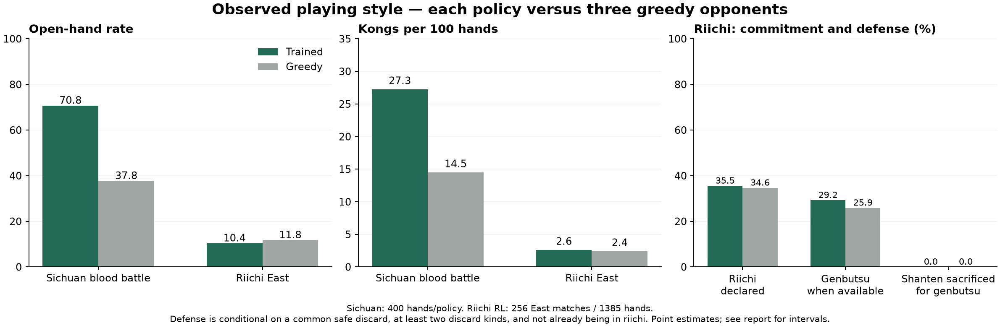

# 四人立直 RL

完整半庄的最终顺位奖励、与净点数目标的配对训练和牌风比较，见 [顺位 RL 实验](PLACEMENT-RL.md)。下文保留首轮净点数模型的设计和结果。

立直与川麻共用 MaskablePPO、候选动作评分网络、并发环境、模型/Adam 保存与恢复、自博弈池；规则状态机仍由各自引擎负责。立直新增独立的 `riichi_visible_v1` 特征合同，不把川麻权重误用于 34 种牌。原川麻 `sichuan_visible_v1` 的 1,549 维特征和旧检查点保持兼容。

## 状态与动作

立直状态为 **2,350 维**，包含 34 种牌的本家张数、可见张数，各家牌河和副露、最近舍牌与摸切/被鸣/和牌/立直标记、座位和场风、本场、供托、局数、点差、立直状态及宣言牌、公开宝牌指示牌与对应宝牌、本家和公开赤牌，以及本家振听、一发状态。不会读取其他家的暗手、未来牌山、未公开里宝牌或密封响应。

候选动作沿用引擎的实体牌 JSON 和 512 格上限，以合法掩码过滤无役和牌、振听荣和、食替和不合法立直后杠等行为。普通五与赤五、摸切与手切、吃牌的不同组合均保留各自身份；只有语义等价的非赤实体副本才合并。网络覆盖 34 种牌，另有 12 维候选特征：向听/进张、和牌/立直/鸣牌/杠标志、摸切、消耗赤牌、舍出宝牌、对立直家的现物、可见张数和役牌身份。候选特征也只用可见信息。

`hints=False` 可用于禁用牌效与安全提示的消融，赤牌和摸切仍属于动作身份。动作在菜单中改变次序不改变共享候选网络的含义。

## Episode、奖励与恢复

首轮以**完整东风战**为 episode，采用项目 `riichi_match_v1`：25,000 点起始、30,000 点目标、连庄、本场、立直棒跨局、目标不足延长、击飞和和牌止，平分按初始座次排序。也支持 `match_length="hand"` 或 `"south"`。训练不保存庞大的逐命令回放，网页和正常 `RiichiMatch` 仍保留可验证回放。

奖励是学习者两次决策之间的点数变化 / **10,000**，`gamma=1`。东风战终场未领取的供托支付给第一名，纳入最后一次奖励；换局不会清零分数或提前结束 episode。学习者第一次可决策前若已有点数变化，也会纳入首个奖励。环境逐个完成的 episode 核对：累计奖励 × scale 必须等于整场最终点数减初始点数。

没有额外奖励立直、碰杠、和牌或保持门前，也没有顺位马点和专门的避四奖励；训练目标是净点数，顺位与四位率另行评测。不能把点数原型称为已经完成顺位优化的比赛级策略。

立直默认跳过强制过牌和强制摸切，这些动作仍由引擎执行，其后续结算仍完整计入奖励。PPO 步数因此主要表示有选择的决策，不能与旧川麻包含强制动作的步数直接比较。对手席位在每场开始选定并冻结，25% 概率由历史模型替换，否则从 greedy / defensive / value 中选择；快照池最近四个模型，8 次更新发布一次。

恢复加载策略、价值网络和 Adam，重新开始牌局，不恢复进行中的牌山。模型清单校验规则、特征维度、动作版本和 SHA-256；推理允许庄家、场风、局数、本场、供托与分数随整场变化，其他规则开关须匹配。CPU/CUDA 使用同一检查点接口。

## 运行

```bash
# 安装方法同 README；CPU 推理不需要 CUDA。
.venv/bin/python -m mahjong_sandbox rl-train \
  --config configs/rl/riichi-cpu.json --output runs/riichi-cpu

.venv/bin/python -m mahjong_sandbox rl-train \
  --resume runs/riichi-cpu/latest.zip --output runs/riichi-cpu --timesteps 65536

.venv/bin/python -m mahjong_sandbox rl-evaluate \
  --model runs/riichi-cpu/best.zip --baseline-model runs/riichi-cpu/warmstart.zip \
  --blocks 16 --seed 200000 --workers 4 --output runs/riichi-cpu/evaluation.json

# 固定总目标、可重入的从零训练；重复执行不会再次追加步数。
.venv/bin/python -m mahjong_sandbox.rl.longrun \
  --config configs/rl/riichi-cpu.json --output runs/riichi-bounded \
  --additional-steps 262144 --eval-blocks 16
```

`configs/rl/riichi-smoke.json` 用于短程验证；正式配置先收集 12,000 条 greedy 决策，做 12 轮行为克隆，再训练 PPO。`warmstart.zip` 是独立评测对照，不参与 PPO 最佳检查点选择。验证集使用逻辑种子 100000–100003，每个种子轮换四座，按整场平均净点数选模。

## 评测与牌风

整场评测报告胡牌率、放铳率、平均整场净点数、平均顺位、一位率和四位率。胡牌率与放铳率按所有实际完成的单手计数，顺位和净点数按整场计数。四座轮换，对手三家相同基线。每个逻辑种子对应 `seed * 256` 的首局牌墙，后续逐局加一；不同逻辑种子不复用彼此整场的牌墙。训练、验证和测试使用分开的种子流。

95% 区间按整场种子块重抽样 2,000 次，保持四座相关性；单手比例重抽样分子/分母，避免把长场与短场简单等权平均。相对其他模型或 bot 的差异也使用同一组种子的配对区间。固定监测集重复使用时会明确说明，不当成全新的测试集。

牌风指标：

- **立直率**：已接受立直的手数 / 全部手数。
- **副露率**：终局时有吃、碰或明杠的手数 / 全部手数，暗杠不算开门。
- **杠频率**：完成的杠数 / 全部手数。
- **自摸占比、平均和牌番数及和牌收款**：按实际和牌样本统计；会保留样本数。
- **面对立直的现物选择率**：本家尚未立直、有至少两种可弃牌且存在对所有立直家的共同现物时，实际选择现物的比例。
- **牺牲向听选现物比例**：在同一条件下，所选现物比最优合法弃牌的向听更差。它是可复核的防守行为代理，不把任何低效率弃牌都解释为主动弃和，也不是对所有危险的完美判断。

川麻一手可能三家先后胡牌，立直的单局通常被一次和牌终止，两者的胡牌率和得分单位不能直接当作实力比较。观察牌风时以各自基线为参照，特别区分“规则本身造成的差别”和模型学出的动作差别。

## 方案参考

本实现复用 [SB3-contrib MaskablePPO](https://sb3-contrib.readthedocs.io/en/master/modules/ppo_mask.html) 的优化与动作掩码，项目自己负责可见状态、跨局环境和评测，不另造优化器框架。参考 [Suphx 原论文](https://arxiv.org/abs/2003.13590) 对麻将隐藏信息与多局收益的讨论；本项目未实现其全局奖励预测、oracle 引导或运行时适配，不能将此原型与该系统的训练规模和实力等同。

<!-- measured-results -->
## 2026-10-20 CPU 实验结果

正式训练使用 16 CPU 请求、32 CPU 上限、32 GiB 内存，无 GPU；128 个并发环境、16 个环境进程。完成 **262,144 个可决策步 / 32 次 PPO 更新 / 3,370 场东风战**，耗时 1,582 秒（含行为克隆与验证），非法动作 0。最佳验证检查点在 **196,608 步**，最后一步没有覆盖它。

训练源码固定在 Git commit `acdcb48845f1bcc6ab4ba39bca2713e9c897af1a`，与原始检查点的包源码哈希一致。网页接入和 reset 保护是在该训练源码之外完成的发布改动，没有热改正在运行的训练代码。完整配置和验证时间线见 [训练记录](riichi-training.json)。

初次独立测试为种子 200000–200015、每个策略 64 场，模型均分 +2,534 点；结果见 [首轮报告](riichi-evaluation.json)。随后固定权重、未调整超参或重新选模，使用 **400000–400063** 的新牌墙扩大确认测试：每个策略 **256 场东风战**，对手均为三家 greedy，四座轮换。下表和牌风图使用这组确认结果；完整数据见 [确认报告](riichi-confirmation.json)。

| 被测策略 | 胡牌率 | 放铳率 | 平均整场净点数 | 平均顺位 | 四位率 |
|---|---:|---:|---:|---:|---:|
| PPO 最佳 | 23.18% | 17.26% | +578.9 | 2.457 | 23.05% |
| 行为克隆初始 | 21.80% | 18.61% | -587.9 | 2.582 | 28.12% |
| greedy | 23.90% | 16.74% | +0.0 | 2.500 | 25.00% |
| defensive | 17.89% | 9.52% | -388.3 | 2.516 | 19.53% |
| value | 13.94% | 15.15% | -2778.9 | 2.820 | 29.30% |

PPO 对 greedy 的净分差为 **+578.9 点/场**，95% 配对种子块区间 **[-684, +1781]**；对行为克隆初始模型的差为 **+1166.8**，区间 **[-563, +2823]**。应结合这些区间判断改善，不能只看均值。对手仅覆盖这里的启发式策略，尚不代表对其他训练模型或人类牌手的实力。

### 观察到的牌风

| 指标 | 川麻 PPO | 川麻 greedy | 立直 PPO | 立直 greedy |
|---|---:|---:|---:|---:|
| 副露率 | 70.75% | 37.75% | 10.40% | 11.77% |
| 每百手完成杠数 | 27.25 | 14.50 | 2.60 | 2.41 |
| 立直率 | — | — | 35.52% | 34.65% |

立直模型的风格是**门清进攻、经常立直、少副露和开杠**。平均和牌 3.40 番，单次和牌平均收款 7921 点；greedy 分别为 3.36 番和 7787 点。门清与立直的特征在行为克隆初始模型中也存在（其立直率 35.37%、副露率 7.10%），观察结果同时包含规则与 teacher 的先验，不能全部归因于 PPO 自行学得。

在有共同现物、尚未立直且有至少两种可弃牌的条件下，模型 **630/2155（29.23%）** 次选择现物，**0** 次牺牲向听数选现物；防守 bot 分别为 1914/1914 和 766 次。这些样本尚未显示模型形成了防守 bot 那样的明确弃和行为。零事件的 bootstrap 区间会退化，不能据此认定真实概率严格为零。

川麻既有模型更常碰杠、追清一色：本次重放中清一色占其和牌的 24.58%，greedy 为 0.71%。川麻模型使用 400 手、相同牌墙逐条复核了原有 800 条双方记录；见 [川麻牌风报告](sichuan-style.json)。两种规则的副露和收益机制不同，跨规则的胡牌率与得分数值不用于比较强弱。



发布检查点见 [立直模型说明](../mahjong_sandbox/models/riichi-high/README.md)。本地全套 154 项测试通过，最终权重的 9 项服务端集成检查通过；CPU 模型、Adam 加载及临时副本继续训练 32 步均通过，原发布权重保持不变。GPU 接口保留，本轮未进行 GPU 训练。

复现确认评测时使用 `rl-evaluate --blocks 64 --seed 400000 --workers 16`，并传入上述最佳模型及同次训练生成的 `warmstart.zip`。两份精简报告已随仓库保存，不需要原始回放即可重画牌风图：

```bash
python -m pip install matplotlib
python scripts/plot_riichi_style.py \
  --riichi docs/riichi-confirmation.json --sichuan docs/sichuan-style.json \
  --output docs/riichi-style.png
```
